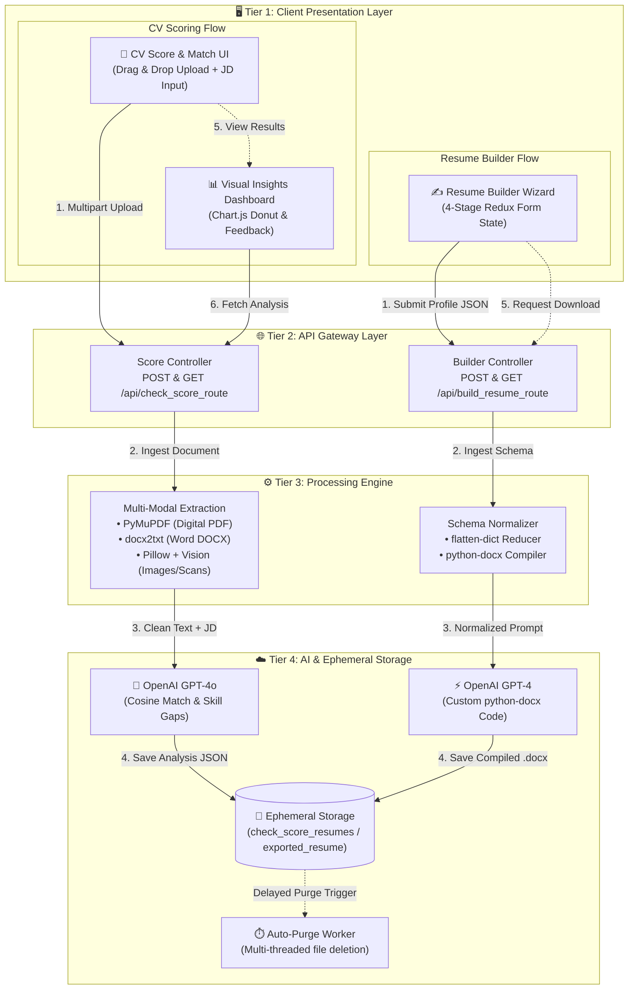
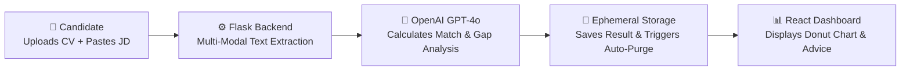
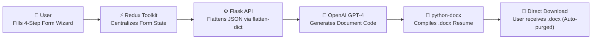

# 🎯 ResumePulse (Danalitics)

> **AI-Powered Career Acceleration Engine** — A full-stack, enterprise-grade resume engineering platform that generates ATS-tailored resumes and calculates deep semantic match scores against job descriptions using Flask, React, and the OpenAI API.

[](https://www.python.org/)
[](https://flask.palletsprojects.com/)
[](https://react.dev/)
[](https://vitejs.dev/)
[](https://openai.com/)
[](https://redux-toolkit.js.org/)
[](https://tailwindcss.com/)
[](LICENSE)

---

<a id="table-of-contents"></a>
## 📑 Table of Contents

1. [🌟 Overview & Sellable Value Proposition](#overview)
2. [⚡ ResumePulse vs. Traditional Resume Tools](#comparison)
3. [✨ Key Product Features](#key-features)
4. [🏛️ System Architecture](#system-architecture)
5. [🔄 Core Execution Workflows](#workflows)
6. [📂 Directory Structure](#directory-structure)
7. [🛠️ Tech Stack & Tooling](#tech-stack)
8. [🚀 Getting Started](#getting-started)
9. [🔌 API Reference](#api-reference)
10. [💼 Resume & Portfolio Highlights](#portfolio-highlights)
11. [🤝 Contributing](#contributing)
12. [👥 Authors](#authors)
13. [📄 License](#license)
14. [📸 Visual UI Walkthrough (WALKTHROUGH.md)](WALKTHROUGH.md)

---

<a id="overview"></a>
## 🌟 Overview & Sellable Value Proposition

In the modern hiring ecosystem, over **75% of resumes are eliminated by Automated Applicant Tracking Systems (ATS)** before ever reaching a human recruiter. Legacy resume builders generate generic templates, while rudimentary keyword matchers perform fragile string comparisons that fail to understand context, seniority, or conceptual equivalence.

**ResumePulse** bridges this critical gap. Engineered as an intelligent, end-to-end career intelligence solution, it empowers job candidates and organizations with:

1. **Deep Semantic ATS Alignment**: Ingests resumes in any format (Digital PDF, Microsoft Word, Scanned PDFs, or high-resolution images) and evaluates them against targeted Job Descriptions (JDs) using **OpenAI GPT-4o**. It calculates semantic similarity scores, identifies matching vs. missing skill clusters, and generates actionable, prioritized recommendations.
2. **Autonomous Resume Generation**: An interactive, multi-step builder backed by Redux Toolkit that compiles user career history into custom, professionally structured resumes exported on the fly into native **Microsoft Word (`.docx`)** documents.
3. **Zero-Trace Ephemeral Security**: Multi-threaded, background auto-purging routines ensure uploaded CVs, extracted data, and generated artifacts are automatically deleted post-request, safeguarding user privacy and preventing data leakage.

<p align="right"><a href="#table-of-contents">⬆️ Back to Menu</a></p>

---

<a id="comparison"></a>
## ⚡ ResumePulse vs. Traditional Resume Tools

| Dimension | 🎯 ResumePulse (AI-Driven) | 🏢 Traditional ATS Checkers / Builders |
|---|---|---|
| **Matching Engine** | **Deep Semantic Alignment (GPT-4o)** — Understands intent, transferable skills, and conceptual context | Rigid exact-string keyword matching; penalizes synonyms and alternate phrasings |
| **Ingestion Pipeline** | **Multi-Modal Parsing** — Digital PDFs (`PyMuPDF`), Word docs (`docx2txt`), Scanned PDFs & Images (Vision OCR) | Limited to clean text or raw text copy-paste |
| **Actionable Feedback** | Categorized gap analysis (Best, Partial, Poor matches), skill requirements, and targeted literature | Raw percentage score with generic keyword counters |
| **Resume Export** | Dynamic compilation into editable, industry-standard **`.docx`** documents via `python-docx` | Locked behind paywalls, rigid non-editable PDFs, or broken HTML prints |
| **Data Privacy** | **Ephemeral Thread Purging** — Automated background deletion of user files within seconds of delivery | Resumes stored permanently in unmanaged cloud buckets |
| **User Experience** | Glassmorphic, reactive UI with real-time Formik/Yup validation, Framer Motion, and Chart.js | Clunky multi-page reloads and static input forms |

<p align="right"><a href="#table-of-contents">⬆️ Back to Menu</a></p>

---

<a id="key-features"></a>
## ✨ Key Product Features

<a id="feature-ingestion"></a>
### 🔍 1. Multi-Modal Ingestion & Vision OCR Pipeline
- **Digital Document Extraction**: Native, high-performance text extraction for standard PDFs using `PyMuPDF` (`fitz`) and Word documents via `docx2txt`.
- **Computer Vision OCR**: Automatically detects scanned documents or raster image files (`.png`, `.jpg`, `.jpeg`, `.tiff`, `.bmp`). Downsamples and encodes images via `Pillow` before streaming them into `GPT-4o Vision` for lossless textual context extraction.

<a id="feature-ats-score"></a>
### 📊 2. AI-Powered ATS Score & Gap Analysis
- **Semantic Similarity Scoring**: Computes a cosine-similarity match percentage between candidate CVs and target job descriptions.
- **Categorized Match Taxonomy**:
  - 🟢 **Best Matched Areas**: Core competencies and experiences strongly aligned with the role.
  - 🟡 **Partially Matched Areas**: Skills adjacent or related to requirements needing explicit framing.
  - 🔴 **Poorly Matched / Missing Areas**: Critical prerequisite gaps to address.
- **Strategic Improvement Roadmap**: Delivers 5–6 actionable bullet points, targeted technical skills to acquire, and recommended industry literature to read.

<a id="feature-builder"></a>
### 📝 3. Redux-Backed Guided Resume Builder
- **Multi-Step Form Architecture**: 4-stage wizard covering Personal Details, Academics & Skills, Projects & Certifications, and Professional Work Experience.
- **Robust Client Validation**: Real-time schema enforcement using `Formik` and `Yup`.
- **Centralized State**: Redux Toolkit slices (`formSlice`) manage complex nested arrays and draft states smoothly across step transitions.

<a id="feature-docx"></a>
### 📄 4. Dynamic `.docx` Synthesis Engine
- **JSON Schema Flattening**: Preprocesses complex nested resume dictionaries into normalized key-value representations using `flatten-dict`.
- **Automated Document Scripting**: Translates flattened profile data into clean `python-docx` code executed in an isolated runtime context to produce clean, professional Word documents ready for download.

<a id="feature-ephemeral"></a>
### 🛡️ 5. Ephemeral File Lifecycle & Memory Management
- **Delayed Background Purging**: Implements multi-threaded `delayed_file_removal` with Flask `@after_this_request` hooks.
- **Zero Disk Bloat**: Both uploaded CV files and exported `.docx` documents are securely removed from the host file system within seconds after transmission.

<p align="right"><a href="#table-of-contents">⬆️ Back to Menu</a></p>

---

<a id="system-architecture"></a>
## 🏛️ System Architecture

ResumePulse follows an enterprise 4-tier architecture comprising the **Client Presentation Layer**, **API & Routing Gateway**, **Processing Pipeline**, and **AI Intelligence & Ephemeral Storage Layer**.



<p align="right"><a href="#table-of-contents">⬆️ Back to Menu</a></p>

---

<a id="workflows"></a>
## 🔄 Core Execution Workflows

To see how individual requests travel through the system step-by-step:

<a id="pipeline-1"></a>
### 1️⃣ Pipeline 1: ATS Resume Score & Job Description Analysis

How an uploaded resume is ingested, evaluated against a job description, and converted into actionable match metrics:



- **Step 1 (Upload)**: Candidate uploads their resume (`.pdf`, `.docx`, or image) and inputs the target Job Description.
- **Step 2 (Multi-Modal Extraction)**: Flask routes the document through `PyMuPDF` (PDFs), `docx2txt` (Word), or Pillow + GPT-4o Vision OCR (scanned PDFs & images).
- **Step 3 (AI Analysis)**: Extracted text and job requirements are analyzed by `GPT-4o` to compute semantic cosine similarity and categorize Best, Partial, and Poor matches.
- **Step 4 (Insights & Auto-Purge)**: Results are rendered on the React dashboard using Chart.js donut visualizations. A background thread automatically deletes the temporary file from the server.

---

<a id="pipeline-2"></a>
### 2️⃣ Pipeline 2: AI Resume Builder & Word (.docx) Export

How a user builds an ATS-optimized resume from scratch and exports an editable Word document:



- **Step 1 (Guided Wizard)**: User inputs details across a 4-step wizard (Personal Details, Academics & Skills, Projects & Certifications, Work Experience).
- **Step 2 (State Management)**: Redux Toolkit validates and normalizes the nested profile state.
- **Step 3 (Data Preprocessing)**: Flask flattens nested dictionaries using `flatten-dict` and prepares the synthesis prompt for `GPT-4-turbo`.
- **Step 4 (Document Compilation)**: Python executes the generated `python-docx` code to construct a formatted Word document.
- **Step 5 (Download & Purge)**: The browser downloads the `.docx` document, and a delayed background thread purges the file from the server.

<p align="right"><a href="#table-of-contents">⬆️ Back to Menu</a></p>

---

<a id="directory-structure"></a>
## 📂 Directory Structure

```text
ResumePulse/
├── Images/                            # Application UI screenshots & flow demonstration
│   ├── 1. Homepage.jpg                # Landing page with social proof and CTAs
│   ├── 2. Check Score.jpg             # Dual-panel upload (Resume + Job Description)
│   ├── 3. Loading.jpg                 # Animated pulse cardiogram processing modal
│   ├── 4. results of check score.jpg  # ATS score breakdown, donut chart & gap taxonomy
│   ├── 5. Build resume.jpg            # Multi-step resume builder wizard (Step 1-5)
│   └── 6. Download Resume Button.jpg  # One-click .docx document export dialog
├── backend/
│   ├── .env.example                   # Environment variable template for backend
│   ├── app.py                         # Primary Flask REST server & route definitions
│   ├── app.yaml                       # Google App Engine / Cloud configuration
│   ├── requirements.txt               # Backend dependencies (Flask, OpenAI, PyMuPDF, etc.)
│   ├── check_score_resumes/           # Ephemeral storage for uploaded CVs & JSON results
│   ├── exported_resume/               # Ephemeral storage for generated .docx resumes
│   └── scripts/
│       ├── __init__.py                # Package initialization
│       ├── app.py                     # Script execution harness
│       ├── build_resume.py            # Data flattening & python-docx execution engine
│       ├── communicate_with_gpt.py    # OpenAI client orchestration (GPT-4o & GPT-4-turbo)
│       ├── extract_text.py            # Multi-modal extraction router (PDF, DOCX, Vision OCR)
│       └── utils.py                   # Image downscaling, base64 encoding, & async file cleanup
├── frontend/
│   ├── .env.example                   # Environment variable template for frontend
│   ├── index.html                     # HTML5 entrypoint with Google Fonts
│   ├── package.json                   # React, Vite, Redux, Tailwind, and UI dependencies
│   ├── vite.config.js                 # Vite bundler configuration
│   ├── tailwind.config.js             # Tailwind CSS tokens and themes
│   └── src/
│       ├── main.jsx                   # React root hydration & Provider bindings
│       ├── App.jsx                    # Client-side routing (React Router v6)
│       ├── App.css / index.css        # Global CSS styles & animation definitions
│       ├── store/
│       │   ├── store.js               # Redux store configuration
│       │   └── formSlice.js           # Multi-step resume builder state management
│       ├── schemas/
│       │   └── index.js               # Formik & Yup validation schemas
│       ├── firebaseContext/
│       │   └── FirebaseContext.jsx    # User authentication & session management
│       ├── components/
│       │   ├── buildResume/           # 4-stage interactive resume builder wizard
│       │   │   ├── Form.jsx           # Builder container & step orchestrator
│       │   │   ├── StepBar.jsx        # Visual step indicator
│       │   │   └── steps/             # PersonalDetails, Education, Projects, Experience, Complete
│       │   ├── checkscore/            # ATS scoring & drag-and-drop file upload
│       │   │   ├── Checkscore.jsx     # Score evaluation screen
│       │   │   └── File-Upload.jsx    # react-dropzone upload module
│       │   ├── herobanner/            # Dynamic hero section with starfield animations
│       │   ├── loadingscreen/         # Dynamic quote loader & error fallbacks
│       │   ├── navbar/                # Navigation bar & mobile drawer
│       │   ├── reviews/               # User feedback carousel (Slick Slider)
│       │   └── SignUp/                # Authentication modal with Aceternity sparkles
│       ├── pages/
│       │   ├── home/Home.jsx          # Landing page
│       │   ├── about/About.jsx        # Team & product mission
│       │   └── templates/             # Curated resume template showcase
│       └── result/
│           ├── Result.jsx             # ATS analysis dashboard
│           └── DonutChart.jsx         # Chart.js match score breakdown
├── LICENSE                            # MIT License (2024)
├── WALKTHROUGH.md                     # Comprehensive visual UI walkthrough guide
└── README.md                          # Comprehensive project documentation
```

<p align="right"><a href="#table-of-contents">⬆️ Back to Menu</a></p>

---

<a id="tech-stack"></a>
## 🛠️ Tech Stack & Tooling

<a id="backend-engine"></a>
### Backend Engine
- **Language & Framework**: [Python 3.10+](https://www.python.org/) | [Flask 3.0+](https://flask.palletsprojects.com/)
- **AI / LLM Integration**: [OpenAI API](https://openai.com/) (`gpt-4o` for semantic scoring & vision, `gpt-4-turbo` for document synthesis)
- **Document Ingestion**: [PyMuPDF (fitz)](https://pymupdf.readthedocs.io/) | [docx2txt](https://github.com/ankushshah89/docx2txt) | [Pillow (PIL)](https://python-pillow.org/)
- **Document Generation**: [python-docx](https://python-docx.readthedocs.io/) | [flatten-dict](https://github.com/ianlini/flatten-dict)
- **Middleware & Utility**: [Flask-CORS](https://flask-cors.readthedocs.io/) | [python-dotenv](https://github.com/theskumar/python-dotenv) | [Werkzeug](https://werkzeug.palletsprojects.com/)

<a id="frontend-client"></a>
### Frontend Client
- **Core Framework**: [React 18.3](https://react.dev/) | [Vite 5.3](https://vitejs.dev/)
- **State Management**: [Redux Toolkit](https://redux-toolkit.js.org/) | [React-Redux](https://react-redux.js.org/)
- **Styling & UI**: [Tailwind CSS](https://tailwindcss.com/) | [SCSS](https://sass-lang.com/) | [Emotion](https://emotion.sh/) | [MUI](https://mui.com/)
- **Animations & Graphics**: [Framer Motion](https://www.framer.com/motion/) | [tsParticles](https://particles.js.org/) | [Aceternity UI](https://ui.aceternity.com/)
- **Forms & Validation**: [Formik](https://formik.org/) | [Yup](https://github.com/jquense/yup)
- **Data Visualization**: [Chart.js](https://www.chartjs.org/) | [react-chartjs-2](https://react-chartjs-2.js.org/)
- **Authentication**: [Firebase Auth](https://firebase.google.com/)

<p align="right"><a href="#table-of-contents">⬆️ Back to Menu</a></p>

---

<a id="getting-started"></a>
## 🚀 Getting Started

<a id="prerequisites"></a>
### Prerequisites

Ensure you have the following installed on your local workstation:
- **Node.js**: `v18.0.0` or higher ([Download](https://nodejs.org/))
- **Python**: `3.10` or higher ([Download](https://www.python.org/))
- **OpenAI API Key**: An active key with access to `gpt-4o` and `gpt-4-turbo` ([Get API Key](https://platform.openai.com/))

---

<a id="clone-repo"></a>
### 1. Clone the Repository

```bash
git clone https://github.com/saransh-2021/ResumePulse.git
cd ResumePulse
```

---

<a id="backend-setup"></a>
### 2. Backend Setup

Open a terminal and navigate to the backend folder:

```bash
cd backend
```

#### Create and Activate a Virtual Environment:
```bash
# Windows
python -m venv venv
venv\Scripts\activate

# Linux / macOS
python3 -m venv venv
source venv/bin/activate
```

#### Install Dependencies:
```bash
pip install -r requirements.txt
```

#### Configure Environment Variables:
Copy the provided `.env.example` template into `.env` inside the `backend/` directory:

```bash
# Linux / macOS
cp .env.example .env

# Windows (PowerShell)
Copy-Item .env.example .env
```

Open `.env` and fill in your OpenAI API credentials:

```env
OPENAI_API_KEY=your_openai_api_key_here
PORT=5000
FLASK_ENV=development
```

#### Run the Flask Server:
```bash
python app.py
```
The backend API server will start at: `http://127.0.0.1:5000`

---

<a id="frontend-setup"></a>
### 3. Frontend Setup

Open a second terminal window and navigate to the frontend folder:

```bash
cd frontend
```

#### Install Node Packages:
```bash
npm install
```

#### Configure Frontend Environment:
Copy the provided `.env.example` template into `.env` in the `frontend/` directory:

```bash
# Linux / macOS
cp .env.example .env

# Windows (PowerShell)
Copy-Item .env.example .env
```

Verify your frontend development endpoints:

```env
REACT_APP_DEVELOPMENT_SERVER=True
REACT_APP_BACKEND_DEVELOPMENT_URL=http://localhost:5000/api
REACT_APP_BACKEND_PRODUCTION_URL=http://localhost:5000
```

#### Launch the Vite Dev Server:
```bash
npm run dev
```

Open your browser at the local URL printed in the terminal (typically `http://localhost:5173`).

<p align="right"><a href="#table-of-contents">⬆️ Back to Menu</a></p>

---

<a id="api-reference"></a>
## 🔌 API Reference

<a id="api-upload"></a>
### 1. Upload CV & Calculate ATS Score
- **Endpoint**: `POST /api/check_score_route/<filename>`
- **Content-Type**: `multipart/form-data`
- **Parameters**:
  - `file`: Resume document (`.pdf`, `.docx`, `.png`, `.jpg`, etc.)
  - `jd_text`: Raw string of the targeted Job Description
- **Response**:
  ```json
  {
    "status": "success",
    "request_id": "result_1729420000_a1b2c3d4"
  }
  ```

<a id="api-score"></a>
### 2. Retrieve ATS Score & Recommendations
- **Endpoint**: `GET /api/check_score_route/<request_id>`
- **Response**:
  ```json
  {
    "similarityScore": 84,
    "matchingAreas": {
      "bestMatched": ["Proficiency in React and modern state management", "Experience with REST API design"],
      "partiallyMatched": ["Familiarity with cloud platforms (AWS vs. GCP)"],
      "poorlyMatched": ["Docker containerization not explicitly stated"]
    },
    "skillsRequired": ["React", "Flask", "TypeScript", "SQLAlchemy", "Docker"],
    "booksToRead": ["Designing Data-Intensive Applications", "Clean Code"],
    "improvementSuggestions": [
      "Explicitly quantify achievements in the work experience section.",
      "Add containerization projects to highlight DevOps proficiency."
    ],
    "thought": "Your experience provides a solid foundation; refining your technical keywords will maximize your interview callback rate."
  }
  ```
  *(Note: An asynchronous background thread purges the JSON result after this request completes).*

<a id="api-build"></a>
### 3. Generate Resume
- **Endpoint**: `POST /api/build_resume_route/0`
- **Content-Type**: `application/json`
- **Payload**: Full structured form data (Personal, Academics, Projects, Experience)
- **Response**:
  ```json
  {
    "status": "success",
    "resume_name": "resume_1729420000_e5f6g7h8"
  }
  ```

<a id="api-download"></a>
### 4. Download Generated Resume (`.docx`)
- **Endpoint**: `GET /api/build_resume_route/<resume_name>`
- **Response**: Binary stream with `Content-Type: application/vnd.openxmlformats-officedocument.wordprocessingml.document`
  *(Note: An asynchronous background thread purges the `.docx` file after delivery).*

<p align="right"><a href="#table-of-contents">⬆️ Back to Menu</a></p>

---

<a id="portfolio-highlights"></a>
## 💼 Resume & Portfolio Highlights

If you are reviewing this project as part of **Saransh Shukla's** engineering portfolio, here is a concise breakdown of the core architectural achievements:

- **AI-Powered Full-Stack Architecture**: Created a website that builds resumes and compares them to job descriptions with the help of the OpenAI API (`GPT-4o` and `GPT-4-turbo`), achieving comprehensive semantic ATS scoring and automated `.docx` synthesis.
- **Robust Flask Backend & Data Orchestration**: Managed the backend with Flask, handling multi-modal data preprocessing (PyMuPDF, docx2txt, and PIL Vision image scaling), postprocessing (dictionary flattening and dynamic docx generation), and session management.
- **Zero-Trace Ephemeral Security**: Engineered an automated file lifecycle using multi-threaded delayed removal (`threading.Thread` and `@after_this_request`) to guarantee user resumes and temporary analysis files are cleanly expunged from the server.
- **Production-Ready Frontend Engineering**: Built an accessible, responsive Single Page Application with React 18, Redux Toolkit, Formik/Yup validation, Framer Motion animations, and interactive Chart.js visualizations.

<p align="right"><a href="#table-of-contents">⬆️ Back to Menu</a></p>

---

<a id="contributing"></a>
## 🤝 Contributing

Contributions, issues, and feature requests are welcome!

1. Fork the Project
2. Create your Feature Branch (`git checkout -b feature/InnovativeFeature`)
3. Commit your Changes (`git commit -m 'feat: add InnovativeFeature'`)
4. Push to the Branch (`git push origin feature/InnovativeFeature`)
5. Open a Pull Request

<p align="right"><a href="#table-of-contents">⬆️ Back to Menu</a></p>

---

<a id="authors"></a>
## 👥 Authors

- **Ritesh Dhiman** : [@RiteshDhiman](https://github.com/RiteshDhiman)
- **Shreya Mathur** : [@Shreya2507](https://github.com/Shreya2507)
- **Saransh Shukla** : [@saransh-2021](https://github.com/saransh-2021)
- **Arjun Bhardwaj** : [@master-coco](https://github.com/master-coco)
- **Garima Jaiswal** : [@GarimaJaiswal12](https://github.com/GarimaJaiswal12)

<p align="right"><a href="#table-of-contents">⬆️ Back to Menu</a></p>

---

<a id="license"></a>
## 📄 License

This project is licensed under the **[MIT License](LICENSE)** - see the [LICENSE](LICENSE) file for details.

<p align="right"><a href="#table-of-contents">⬆️ Back to Menu</a></p>
