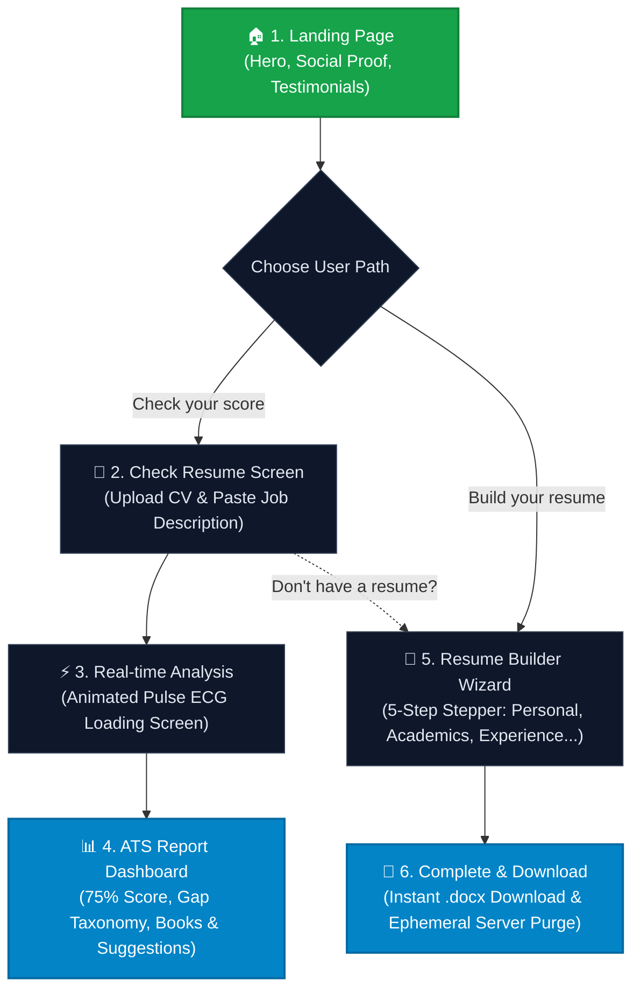

# 🚀 ResumePulse — Visual Workflow & UI Walkthrough

Welcome to the visual tour of **ResumePulse**! This guide illustrates the complete end-to-end user experience, from first landing on the platform to performing deep AI ATS evaluations and building customized, ATS-friendly Word resumes.

---

## 🗺️ Application Flow Overview

---

## 📸 Step-by-Step UI Flow

### Step 1: Hero Landing Page & Platform Overview

The entry point of ResumePulse features a cosmic, starfield aesthetic with high-contrast emerald green accents. Users are introduced to the value proposition—*"Beat the competition with a resume that resonates"*—with instant access to the two primary workflows.

  
  
<em>Figure 1: ResumePulse Homepage with dual CTAs, hiring company social proof, and interactive user reviews.</em>

#### Key Interface Elements:
- **Global Navigation**: Header with logo, quick links (`Home`, `About`, `Create`), and Firebase-backed `Log In/Signup`.
- **Primary Calls-to-Action**:
  - `Check your score`: Direct route to the ATS checker.
  - `Build your resume`: Direct route to the interactive multi-stage resume wizard.
- **Social Proof**: Trust indicators showcasing candidates hired at Disney, Airbnb, Apple Music, Samsung, Quora, and more.
- **Testimonial Showcase**: Horizontal review cards highlighting user feedback and real rating scores.

---

### Step 2: Resume Ingestion & Job Description Input

The **Check Resume** workspace is divided into two intuitive panels for submitting candidate and job materials.

  
  
<em>Figure 2: Dual-panel upload workspace for candidate resume and target job description.</em>

#### Key Interface Elements:
- **Left Panel (Upload Resume)**:
  - Drag-and-drop file upload zone supporting **PDF**, **DOCX**, and scanned image formats (`.png`, `.jpg`, `.jpeg`).
  - Active file indicator displaying the selected document (e.g., `Arjun Resume.pdf`).
  - Shortcut link: *"Don't have a resume? Build your resume"*.
- **Right Panel (Job Description)**:
  - Multi-line text editor for pasting targeted job requirements, responsibilities, and required competencies.
- **Action Trigger**: Prominent `Check Score` button submitting multi-part form data to `POST /api/check_score_route/0`.

---

### Step 3: Asynchronous AI Processing & Pulse Loading Screen

While the backend ingests the document, detects formatting, downscales raster images, and queries OpenAI's `GPT-4o`, the user is greeted with a sleek modal featuring the signature ResumePulse animated cardiogram.

  
  
<em>Figure 3: Animated cardiogram heartbeat loading modal with background blur effect.</em>

#### Under the Hood:
1. **Document Text Extraction**: `PyMuPDF` parses digital text; if scanned, `Pillow` downsizes image buffers and dispatches them to `GPT-4o Vision`.
2. **Semantic Comparison**: GPT-4o analyzes resume experience against the JD role constraints.
3. **Ephemeral Cache**: Results are written to a temporary JSON file and returned with a unique request ID.

---

### Step 4: Comprehensive ATS Score & Gap Analysis Dashboard

Once evaluation completes, the user is navigated to the comprehensive **Resume Report** dashboard featuring rich data visualization and actionable feedback.

  
  
<em>Figure 4: Full ATS analysis report featuring Donut Chart match score, color-coded gap analysis, and tailored recommendations.</em>

#### Dashboard Breakdown:
- **Motivational Header**: A dynamic uplifting thought tailored to encourage the candidate regardless of the raw percentage.
- **Categorized Match Taxonomy**:
  - 🟢 **Best Matched**: Highlights exact qualifications (e.g., Java, Python, JavaScript, Web Development, MySQL/MongoDB).
  - 🟡 **Partially Matched**: Identifies skills adjacent to JD requirements that need stronger framing (e.g., Git/GitHub version control, Cybersecurity).
  - 🔴 **Poorly Matched**: Identifies out-of-scope experience or gaps in required qualifications.
- **Match Score Donut Chart**: Interactive Chart.js donut displaying overall semantic ATS alignment (e.g., **75% Match**).
- **Skills Required**: Clean list of prerequisite technical skills extracted from the job posting.
- **Curated Reading List ("Books to Read")**: Recommended software engineering literature tailored to fill candidate knowledge gaps (*Clean Code*, *Design Patterns*, *You Don't Know JS*, *Python Crash Course*, *The Pragmatic Programmer*).
- **Targeted Improvements / Suggestions**: 5 concrete bullet points detailing exact resume revisions to boost interview callback probability.

---

### Step 5: Interactive Multi-Step Resume Builder

For candidates starting from scratch or refining their profiles, the guided **Build your Resume** wizard provides an organized 5-stage form.

  
  
<em>Figure 5: Step 1 (Personal Details) of the 5-stage resume generation wizard.</em>

#### Wizard Workflow:
1. **Step 1 — Personal Details**: Name, Email, Phone number, Target Role, GitHub profile, LinkedIn, Portfolio, Location.
2. **Step 2 — Academics**: Degrees, institutions, GPA, relevant coursework, graduation dates.
3. **Step 3 — Projects & Certifications**: Technical projects, live demo links, repository URLs, credentials.
4. **Step 4 — Experience**: Employment history, quantified accomplishments, responsibilities.
5. **Step 5 — Complete**: Final review and document generation trigger.

*State is managed globally in Redux Toolkit with Formik and Yup schema validation on every input field.*

---

### Step 6: Word Document (.docx) Export & Ephemeral Purge

Upon reaching Step 5, the user is presented with a clean download dialog to obtain their newly synthesized resume.

  
  
<em>Figure 6: Download completion modal for instant retrieval of the generated Word document (.docx).</em>

#### Document Generation & Privacy Lifecycle:
1. Form state is submitted to `POST /api/build_resume_route/0`.
2. Python flattens the nested dictionary and leverages `python-docx` to format typography, margins, headers, and bullet alignments into an editable `.docx` file.
3. Clicking **Download** triggers `GET /api/build_resume_route/<resume_name>`.
4. As soon as the file is delivered to the user's browser, a background worker thread (`@after_this_request` with `threading.Thread`) purges the document from the server within 10 seconds, guaranteeing zero-trace candidate privacy.

---

## 📋 Visual State Reference Table

| # | Screen / State | Route / Component | Primary User Objective | Backend / Tech Involved |
|---|---|---|---|---|
| **1** | **Homepage** | `/` (`Home.jsx`) | Learn product value; choose Check Score or Builder | React Router, Aceternity UI, Tailwind CSS |
| **2** | **Check Resume** | `/checkscore` (`Checkscore.jsx`) | Upload CV and input target Job Description | React-Dropzone, FormData, Multi-part upload |
| **3** | **Loading** | Overlay (`loadingscreen/`) | Visual feedback during async document analysis | PyMuPDF, docx2txt, Pillow Vision OCR, GPT-4o |
| **4** | **Resume Report** | `/result` (`Result.jsx`) | Review ATS score, gap taxonomy, and reading list | Chart.js (`DonutChart.jsx`), GPT-4o JSON output |
| **5** | **Resume Builder** | `/create` (`Form.jsx`) | Step-by-step entry of candidate experience & info | Redux Toolkit (`formSlice.js`), Formik, Yup |
| **6** | **Download Modal** | `/create` (`Complete.jsx`) | Export polished `.docx` document with instant download | `python-docx`, Threaded ephemeral file purge |

---

*Return to [README.md](README.md) for installation, environment configuration, and API reference.*
